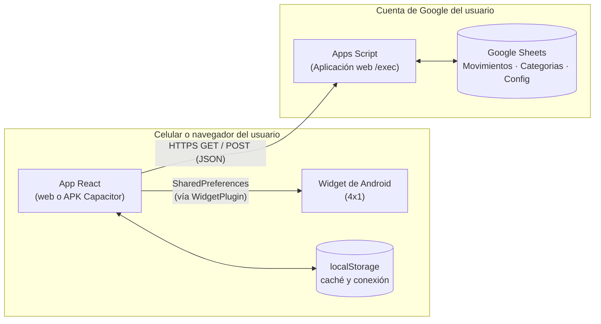
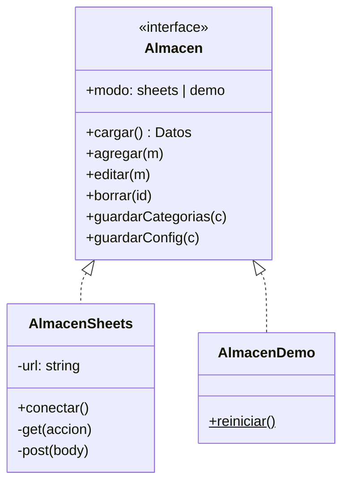
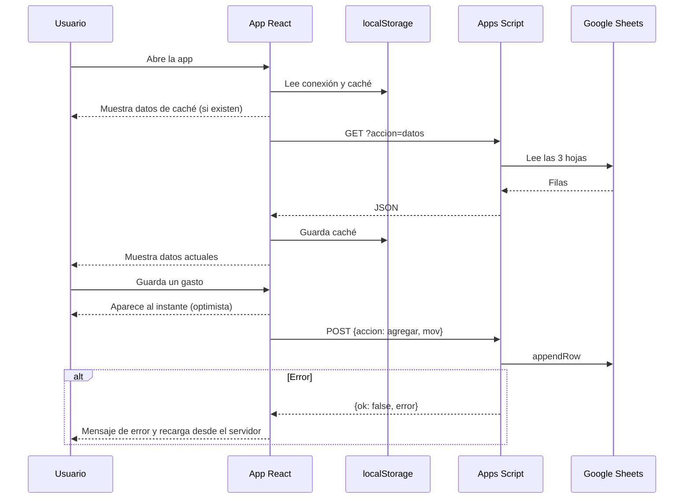
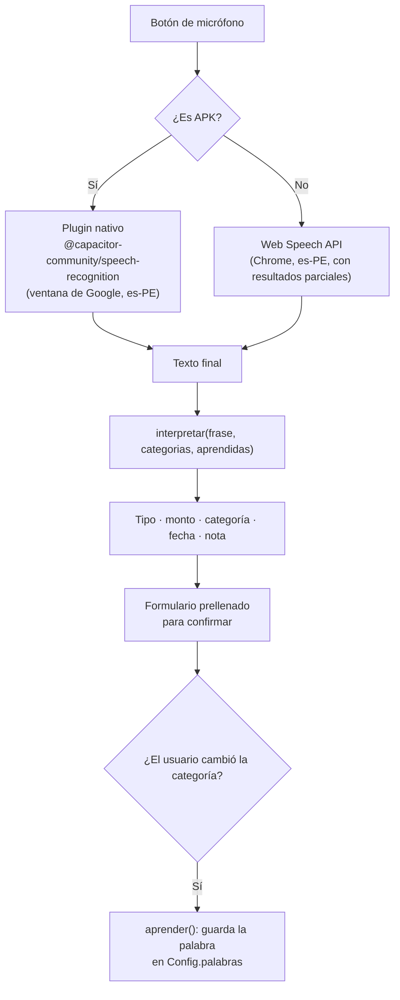
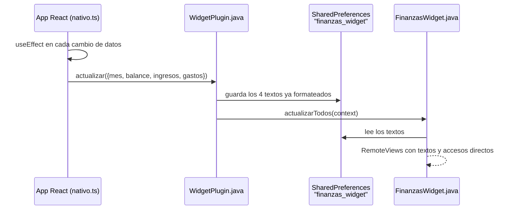
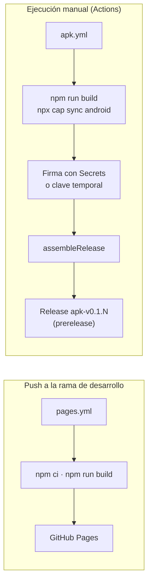

# Arquitectura de Mis Finanzas

Documento técnico de cómo está construida la app: qué piezas hay, cómo se comunican, dónde se guardan los datos y cómo se publica. Está escrito a partir del código del repositorio; si algo cambia en el código, este documento debe actualizarse.

---

## 1. Visión general

Mis Finanzas es una app personal de ingresos y gastos. Tiene una particularidad: **no tiene servidor propio ni base de datos centralizada**. Cada usuario guarda sus datos en **su propia hoja de Google Sheets**, y la comunicación con esa hoja la hace un pequeño script de Google Apps Script que el propio usuario instala.



Piezas principales:

| Pieza | Dónde está | Qué hace |
|---|---|---|
| App web | `src/` | Interfaz React. Se sirve desde GitHub Pages y también es el contenido del APK. |
| Envoltorio nativo | `android/`, `capacitor.config.ts` | Capacitor 8 empaqueta la web en un APK y aporta acceso a plugins nativos. |
| Widget | `android/…/FinanzasWidget.java`, `res/layout/widget_finanzas.xml` | Muestra el balance del mes en la pantalla de inicio. |
| Backend | `apps-script/Code.gs` | Lo pega cada usuario en su hoja. Expone una API JSON sobre la hoja. |
| Datos | Google Sheets del usuario | Fuente de verdad. |
| Caché | `localStorage` del dispositivo | Copia local para abrir al instante y para el modo demo. |

**Decisiones de diseño que explican casi todo lo demás:**

1. **Privacidad por diseño.** Los datos viven en la cuenta de Google de cada persona. El desarrollador no ve ningún dato.
2. **Sin costo de infraestructura.** Todo corre en servicios gratuitos: GitHub Pages, Apps Script y Google Sheets.
3. **Sin autenticación propia.** La URL `/exec` del script funciona como contraseña. Quien la tenga puede leer y escribir la hoja.
4. **Todo el procesamiento de lenguaje es local.** El dictado por voz y la interpretación de frases ocurren en el dispositivo, sin enviar texto a ningún servicio de IA.

---

## 2. Estructura del repositorio

```
App-finanzas-prueba/
├── CLAUDE.md                  Guía de trabajo y contexto del proyecto
├── README.md                  Guía de uso y desarrollo
├── docs/ARQUITECTURA.md       Este documento
├── apps-script/Code.gs        Backend que se pega en la hoja del usuario
├── src/                       App web (React + TypeScript)
│   ├── main.tsx               Punto de entrada; monta el proveedor de estado
│   ├── App.tsx                Shell: navegación, tema, widget, formulario
│   ├── index.css              Tokens de diseño y utilidades Tailwind
│   ├── api/
│   │   ├── types.ts           Modelo de datos e interfaz Almacen
│   │   ├── sheets.ts          Implementación contra Apps Script
│   │   └── demo.ts            Implementación en localStorage (modo demo)
│   ├── lib/
│   │   ├── store.tsx          Estado global y escrituras optimistas
│   │   ├── stats.ts           Totales, tendencia y agrupación por categoría
│   │   ├── interpretar.ts     Parser de frases dictadas
│   │   ├── voz.ts             Dictado: nativo (APK) o Web Speech (navegador)
│   │   ├── nativo.ts          Widget, deep links y botón atrás de Android
│   │   └── format.ts          Fechas, meses, moneda y utilidades
│   ├── pages/                 Resumen, Movimientos, Ajustes, Conectar
│   └── components/            Formulario, filas, gráfico, selector de mes, hoja
├── android/                   Proyecto nativo generado por Capacitor
│   └── app/src/main/java/pe/misfinanzas/app/
│       ├── MainActivity.java  Arranca Capacitor y registra WidgetPlugin
│       ├── WidgetPlugin.java  Puente JS → Android para actualizar el widget
│       └── FinanzasWidget.java Proveedor del AppWidget
└── .github/workflows/
    ├── pages.yml              Despliega la web en GitHub Pages (en cada push)
    └── apk.yml                Compila el APK firmado (manual)
```

---

## 3. Capa de datos

### 3.1 Modelo de dominio (`src/api/types.ts`)

```ts
type Tipo = 'ingreso' | 'gasto';

interface Movimiento {
  id: string;         // uid() en el cliente: base36 de la fecha + azar
  fecha: string;      // "AAAA-MM-DD"
  tipo: Tipo;
  categoria: string;  // id de Categoria
  monto: number;
  nota: string;
  creado: string;     // ISO 8601, marca de creación
}

interface Categoria {
  id: string;
  nombre: string;
  tipo: Tipo;
  icono: string;      // emoji
  color: string;      // hex
  presupuesto: number | '';  // tope mensual opcional
}

interface Config {
  nombre: string;
  moneda: string;     // p. ej. "PEN"
  metaAhorro: number;
  tema: 'sistema' | 'claro' | 'oscuro';
  [clave: string]: string | number;  // claves adicionales (ver 3.4)
}

interface Datos { movimientos; categorias; config; urlHoja?; nombreHoja? }
```

### 3.2 Hojas de Google Sheets

El script crea tres pestañas con cabecera en la primera fila (`preparar()` en `Code.gs`):

| Hoja | Columnas | Notas |
|---|---|---|
| `Movimientos` | `id`, `fecha`, `tipo`, `categoria`, `monto`, `nota`, `creado` | La columna `fecha` tiene formato de texto para evitar que Sheets la convierta en fecha y cambie la zona horaria. |
| `Categorias` | `id`, `nombre`, `tipo`, `icono`, `color`, `presupuesto` | Se crea con 10 categorías de ejemplo (3 de ingreso, 7 de gasto). |
| `Config` | `clave`, `valor` | Pares clave-valor. Se crea con `nombre`, `moneda`, `metaAhorro` y `tema`, más `version`. |

Las hojas `Categorias` y `Config` se **reescriben completas** en cada guardado. `Movimientos` se modifica fila a fila.

### 3.3 Almacenes: la interfaz `Almacen`

Todo el acceso a datos pasa por una interfaz única (`src/api/types.ts`), que tiene dos implementaciones intercambiables:



- **`AlmacenSheets`** (`sheets.ts`) hace `fetch` a la URL `/exec`. Las lecturas son `GET ?accion=datos`. Las escrituras son `POST` con un JSON en el cuerpo. El cuerpo se envía como `text/plain` a propósito: así el navegador no hace una petición "preflight" de CORS, que Apps Script no soporta.
- **`AlmacenDemo`** (`demo.ts`) guarda todo en `localStorage` bajo la clave `finanzas.demo`. La primera vez genera 6 meses de datos de ejemplo.

### 3.4 Claves de `Config`

| Clave | Quién la escribe | Uso |
|---|---|---|
| `nombre`, `moneda`, `metaAhorro`, `tema` | Ajustes | Preferencias generales |
| `ocultarBalance` | Ajustes (`'si'` / `'no'`) | Oculta el balance con `***` en el resumen y en el widget |
| `palabras` | Editor de categoría (JSON) | Palabras aprendidas para el dictado, por id de categoría |
| `version` | `preparar()` | Versión del esquema del script |

Como `Config` es una lista clave-valor, agregar una clave nueva **no requiere volver a desplegar el script**. Por eso el código guarda preferencias nuevas aquí y no en nuevas hojas.

### 3.5 Contrato de la API (`Code.gs`)

| Método | Acción | Efecto |
|---|---|---|
| GET | `ping` | Devuelve `{ok, version}`. Sirve para comprobar que la URL responde. |
| GET | `datos` | Devuelve `listo`, `nombreHoja`, `urlHoja`, `movimientos`, `categorias`, `config`. Si las hojas no existen, devuelve `listo: false`. |
| POST | `setup` | Crea las hojas, les da formato y devuelve los datos. |
| POST | `agregar` | Añade una fila a `Movimientos`. |
| POST | `editar` | Busca la fila por `id` y la sobrescribe. |
| POST | `borrar` | Busca la fila por `id` y la elimina con `deleteRow`. |
| POST | `guardarCategorias` | Reescribe `Categorias`. |
| POST | `guardarConfig` | Reescribe `Config`. |

Todas las respuestas son JSON con `ok: true` o `ok: false, error`. Las escrituras toman un `LockService` de script durante hasta 20 segundos, así que dos escrituras simultáneas (por ejemplo, desde el celular y desde la web) se ejecutan una después de otra.

---

## 4. Estado y flujo de datos en la app web

### 4.1 Proveedor de estado (`src/lib/store.tsx`)

`ProveedorFinanzas` envuelve toda la app y expone un contexto con los datos y las acciones (`useFinanzas()`). Maneja:

- **Conexión** (`finanzas.conexion` en localStorage): `{modo: 'sheets', url}`, `{modo: 'demo'}` o nada (muestra la pantalla Conectar).
- **Caché** (`finanzas.cache`): copia de los últimos datos de Sheets. Permite mostrar la app al instante mientras se recargan los datos reales.
- **Escrituras optimistas**: `optimista(cambio, accion)` aplica el cambio al estado de inmediato, lanza la petición en segundo plano y cuenta las pendientes (`sincronizando`). Si falla, muestra un error y vuelve a cargar los datos reales del servidor para corregir el estado.

### 4.2 Ciclo de vida de una sesión



### 4.3 Cálculos (`src/lib/stats.ts`)

Todas las cifras del resumen se calculan **en el cliente** a partir de la lista de movimientos:

- `totales(movs)`: suma ingresos y gastos; el balance es ingresos menos gastos.
- `delMes(movs, mes)`: filtra por el prefijo `AAAA-MM` de la fecha.
- `tendencia(movs, mes, 6)`: totales de los últimos 6 meses para el gráfico.
- `porCategoria(movs, cats, tipo)`: agrupa montos por categoría, con porcentaje y tope.

Esto significa que, con unos pocos miles de movimientos, el cálculo es instantáneo y no hace falta una consulta al servidor.

---

## 5. Interfaz y navegación

### 5.1 Shell (`src/App.tsx`)

- Cuatro zonas de navegación inferior: **Resumen**, **Movimientos**, un botón central **+** para agregar y **Ajustes**. El estado de pestaña es local (`useState`), no hay router.
- Si no hay conexión, se renderiza `Conectar` (URL de Apps Script o modo demo).
- El tema se aplica con el atributo `data-theme` en `<html>`. Si la preferencia es `sistema`, se lee `prefers-color-scheme`.

### 5.2 Páginas y componentes

| Archivo | Responsabilidad |
|---|---|
| `pages/Resumen.tsx` | Tarjeta de balance (con modo oculto), meta de ahorro, gráfico de 6 meses, gastos por categoría, últimos movimientos |
| `pages/Movimientos.tsx` | Lista del mes agrupada por día, con búsqueda y filtros |
| `pages/Ajustes.tsx` | Preferencias (nombre, moneda, meta, tema, ocultar balance), categorías con su editor, conexión |
| `pages/Conectar.tsx` | Pantalla inicial: pegar la URL de Apps Script, o entrar en modo demo |
| `components/FormMovimiento.tsx` | Alta y edición de un movimiento; también es el destino del dictado por voz |
| `components/Hoja.tsx` | Panel deslizable reutilizable |
| `components/GraficoTendencia.tsx` | Gráfico de barras con Recharts |
| `components/SelectorMes.tsx` | Navegación entre meses |

---

## 6. Dictado por voz y lenguaje natural

El dictado convierte una frase como *"gasté 25 soles en almuerzo ayer"* en un movimiento listo para revisar. Tiene dos capas:



### 6.1 Captura (`src/lib/voz.ts`)

- En el APK se usa el reconocimiento nativo de Android. Antes pide permiso de micrófono y comprueba que el dispositivo tenga un servicio de voz.
- En el navegador se usa `SpeechRecognition` o `webkitSpeechRecognition`. Envía resultados parciales y un resultado final.

### 6.2 Interpretación (`src/lib/interpretar.ts`)

Todo ocurre en el dispositivo, en este orden:

1. **Normalización**: pasa a minúsculas, quita tildes y signos.
2. **Números en palabras**: convierte "mil doscientos cincuenta" en `1250`.
3. **Monto, fecha y tipo**: reconoce el monto (por ejemplo "25" o "25 con 50"), las fechas "hoy", "ayer" o "anteayer", y el tipo de movimiento. Las palabras de moneda como "soles", "lucas" o "dólares" se tratan como relleno y no cambian el monto.
4. **Categoría**: busca palabras clave en cada categoría. Las fuentes son el nombre de la categoría, una lista base en `PALABRAS_BASE` (comida, transporte, vivienda, etc.) y las palabras aprendidas del usuario.
5. **Nota**: el resto de la frase, sin lo que ya se usó como monto, fecha o categoría.

### 6.3 Aprendizaje

Cuando el usuario corrige la categoría que propuso la app, `aprender()` añade el concepto a la lista de esa categoría. La lista se guarda como JSON en la clave `palabras` de `Config`, así que se sincroniza entre dispositivos.

---

## 7. Integración con Android

### 7.1 Puente JavaScript → Android



Detalles importantes:

- **El widget no calcula nada.** La app le envía el texto ya formateado (por ejemplo `S/ 2,946.00`). Así el formato de moneda se define en un solo lugar.
- **El widget se actualiza solo cuando la app corre.** Si cambian los datos desde otro dispositivo, el widget queda con la última cifra hasta que se abra la app.
- **Modo oculto:** cuando `ocultarBalance` está activo, la app envía `S/ ***` al widget. La cifra real nunca sale de la app hacia el widget.

### 7.2 Accesos directos y deep links

El widget tiene cuatro zonas clicables. Cada una abre `MainActivity` con una URL:

| URL | Efecto en la app |
|---|---|
| `misfinanzas://inicio` | Abre la app en Resumen |
| `misfinanzas://voz` | Abre el formulario con el dictado activado |
| `misfinanzas://nuevo/gasto` | Abre el formulario con tipo gasto |
| `misfinanzas://nuevo/ingreso` | Abre el formulario con tipo ingreso |

`nativo.ts` las recibe por `App.getLaunchUrl()` (si la app se abrió con el enlace) y por `appUrlOpen` (si ya estaba abierta). La misma lógica acepta `?nuevo=gasto` en la web instalada como atajo.

### 7.3 Botón atrás

El botón atrás de Android cierra primero el formulario o vuelve a Resumen, y solo sale de la app si ya está en Resumen sin paneles abiertos.

---

## 8. Publicación y compilación



| Workflow | Disparador | Resultado |
|---|---|---|
| `pages.yml` | Push a `main` o a la rama de desarrollo | Web publicada en GitHub Pages |
| `apk.yml` | Manual (`workflow_dispatch`) | APK firmado publicado como prerelease `apk-v0.1.N` |

**Firma del APK.** Si existen los Secrets `FINANZAS_KEYSTORE_BASE64` y `FINANZAS_KEYSTORE_PASSWORD`, el APK se firma con esa clave fija y se puede instalar encima de la versión anterior. Si no existen, se genera una clave temporal en cada compilación; en ese caso hay que desinstalar la versión previa. La clave nunca se guarda en el repositorio.

**Versiones fijadas.** Vite 6, `@vitejs/plugin-react` 4 y TypeScript 5 están fijados por conflictos de peer dependencies. Capacitor está en la versión 8.

**Comandos locales:**

```bash
npm ci && npm run dev         # desarrollo en http://localhost:5173
npm run build                 # compila la web en dist/
npx cap sync android          # copia dist/ al proyecto Android
cd android && ./gradlew assembleRelease   # APK (requiere Java 21)
```

---

## 9. Seguridad y privacidad

| Tema | Situación actual | Comentario |
|---|---|---|
| Autenticación | La URL `/exec` es el único control de acceso | Quien la tenga puede leer y escribir la hoja. Es el punto más sensible. |
| Datos en tránsito | HTTPS entre la app y Apps Script | Google gestiona los certificados. |
| Datos en el dispositivo | Caché y conexión en `localStorage` | Sin cifrado adicional. Se borran al desconectar. |
| Secretos en el repo | Ninguno; la firma va en Secrets de GitHub | El repositorio es público. |
| Análisis externos | Ninguno en el código | El dictado nativo usa el servicio de voz de Google del propio celular. |
| Widget | El texto del balance queda en SharedPreferences | Si el balance está oculto, solo se guarda `***`. |

**Mejora posible:** Google Sign-In (ya listado como pendiente en `CLAUDE.md`) permitiría autenticar sin depender de una URL secreta, pero requiere configurar un proyecto en Google Cloud.

---

## 10. Limitaciones conocidas

- **Concurrencia limitada.** Dos dispositivos que editan a la vez no se fusionan: gana la última escritura. Las categorías y la configuración se reescriben completas, así que un guardado simultáneo puede pisar al otro.
- **Latencia de Apps Script.** Cada escritura tarda uno o dos segundos. Por eso se usan escrituras optimistas.
- **Widget sin datos en vivo.** Se actualiza solo al abrir la app.
- **Búsqueda lineal.** `editar` y `borrar` recorren la columna `id` para encontrar la fila. Con decenas de miles de filas se notaría.
- **Sin pruebas automáticas.** El repositorio no tiene tests unitarios ni de integración. Las pruebas se hacen manualmente y con Playwright en la web. El dispositivo real o el emulador no se pueden verificar desde el entorno de desarrollo.
- **Cambios en `Code.gs` requieren redespliegue.** Cada usuario debe pegar el script nuevo y crear una nueva implementación. Por eso conviene guardar datos nuevos en `Config`.

---

## 11. Cómo extender la app

**Agregar una preferencia nueva:**
1. Añadir el campo en `Config` (`src/api/types.ts`) con un valor por defecto en `CONFIG_BASE`.
2. Crear el control en `pages/Ajustes.tsx`.
3. Usarla donde haga falta, leyendo `datos.config.<clave>`.
4. No hace falta tocar `Code.gs`.

**Agregar un campo a los movimientos:** es un cambio que sí requiere redespliegue. Hay que añadir la columna en `HOJAS` y `filaMovimiento()` de `Code.gs`, actualizar `Movimiento` en los tipos y los formularios.

**Agregar una acción nueva al backend:** añadir un `case` en `doPost` de `Code.gs`, una función que haga el trabajo y un método en `Almacen`, `AlmacenSheets` y `AlmacenDemo`.

**Agregar un dato al widget:** añadir el campo a la llamada de `actualizarWidget` en `App.tsx`, al `interface` de `nativo.ts` y a `WidgetPlugin.java`, y mostrarlo en `widget_finanzas.xml` y `FinanzasWidget.java`.

---

## 12. Glosario

- **Apps Script:** plataforma de Google para ejecutar JavaScript sobre Google Workspace. Aquí convierte la hoja en una API JSON.
- **`/exec`:** la URL de una implementación de aplicación web de Apps Script.
- **Capacitor:** herramienta que empaqueta una web como app nativa Android o iOS.
- **Optimista:** la interfaz se actualiza antes de confirmar con el servidor. Si la confirmación falla, se revierte.
- **AppWidget:** componente de la pantalla de inicio de Android que muestra información sin abrir la app.
- **Deep link:** URL con un esquema propio (`misfinanzas://`) que abre la app en una pantalla concreta.
